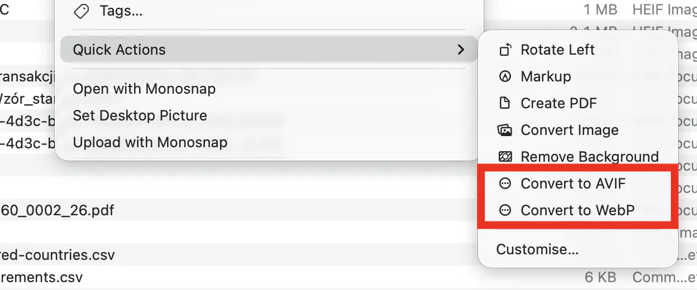
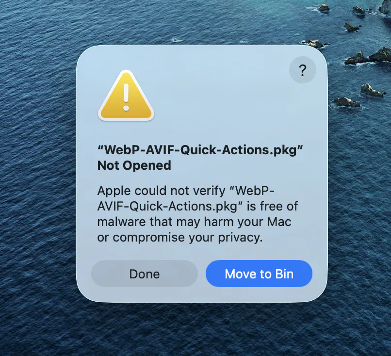
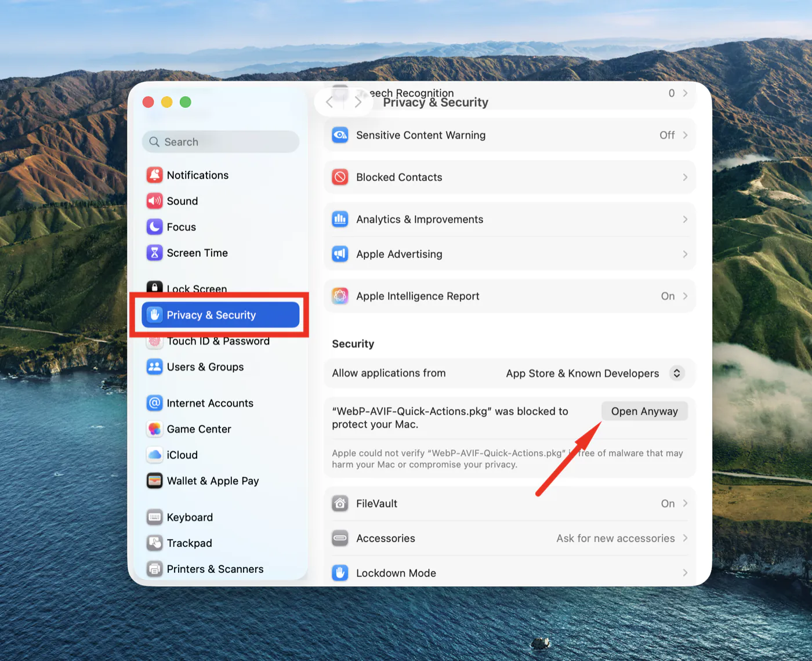
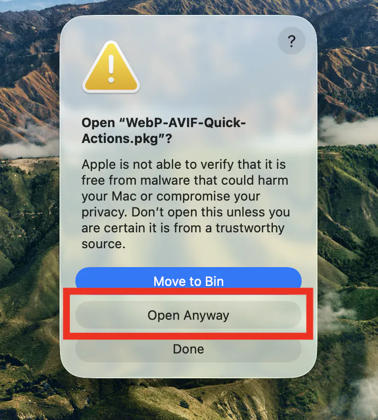

# Convert to WebP / AVIF - Finder Quick Actions for macOS

Right-click any image in Finder, choose **Quick Actions → Convert to WebP** (or
**Convert to AVIF**), and a compressed copy appears next to the original.



*This screenshot was converted with the action itself: 445 KB as PNG, 33 KB as WebP.*

macOS can convert images to JPEG, PNG and HEIF from Finder, but not to WebP or
AVIF. These two Quick Actions fill that gap. They run locally, so nothing is
uploaded to an online converter.

- Works on many files at once: select them all, right-click, done.
- Takes PNG, JPEG, TIFF, HEIC and anything else macOS can open.
- Never touches the original or any other existing file. The new file gets the
  same name with a new extension; if that name is taken, it becomes
  `name 2.webp`, `name 3.webp` and so on. Files already in the target format
  are skipped.
- Shows a notification when it is finished.
- **Keeps the colour profile.** Screenshots on a Mac are tagged Display P3. Most
  `cwebp` one-liners drop that tag, which makes colours look washed out. Here
  WebP keeps the ICC profile. AVIF stores sRGB and Display P3 as compact CICP
  colour tags, and keeps any other profile (Adobe RGB, for example) as ICC.
- Removes EXIF and XMP metadata (camera, location and so on). Photos that rely on
  the EXIF orientation tag, such as portrait shots from a phone, are rotated in
  the pixels first, so they still come out the right way up.

## Install

**[Download the installer (.pkg)](https://github.com/piotrekbednus/macos-webp-quick-action/releases/latest/download/WebP-AVIF-Quick-Actions.pkg)**,
open it and follow the steps. You need macOS 11 or later, on Apple Silicon or Intel. The installer
includes the encoders, so you do not need Homebrew.

The installer is not signed with an Apple Developer ID yet, so the first time
macOS says it cannot verify it:

1. Click **Done**, not Move to Bin (Move to Trash on some Macs).

   

2. Open **System Settings → Privacy & Security** and scroll down to Security.
   Next to “WebP-AVIF-Quick-Actions.pkg” was blocked to protect your Mac,
   click **Open Anyway**. The button stays there for about an hour after you
   tried to open the file.

   

3. macOS asks once more. Click **Open Anyway** again and confirm with your
   password or Touch ID if asked. The installer opens.

   

### Or in one line, in Terminal

```bash
curl -fsSL https://raw.githubusercontent.com/piotrekbednus/macos-webp-quick-action/main/quick-install.sh | bash
```

[quick-install.sh](quick-install.sh) downloads the same installer and runs it
with macOS's own `installer` command, so the steps above are not needed. It
asks for your password.

You can also build the installer yourself from this repository (see
[Building the installer](#building-the-installer)), or use the Homebrew route
below.

If the actions do not show up, relaunch Finder (Option + right-click the Finder
icon in the Dock → Relaunch), or turn them on in **System Settings → Keyboard →
Keyboard Shortcuts → Services**. That is also where you can give them a
keyboard shortcut.

The first time you run one on your Desktop or in Downloads, macOS may ask for
permission to access that folder.

To uninstall, open `/Library/Application Support/WebP AVIF Quick Actions` in
Finder (Go → Go to Folder…) and double-click `Uninstall.command`.

### With Homebrew instead

```bash
git clone https://github.com/piotrekbednus/macos-webp-quick-action.git
cd macos-webp-quick-action
./install.sh
```

`install.sh` offers to run `brew install webp libavif` if the encoders are
missing, copies both actions to `~/Library/Services` and refreshes Finder's
menu. Uninstall with `./uninstall.sh`.

## What you get

One 2126×1810 browser screenshot (Display P3), default settings:

| File | Size |
|---|---|
| PNG (original) | 1,045 KB |
| WebP, quality 80 | 123 KB |
| AVIF, quality 70, 4:4:4 | 112 KB |

That is a single image, not a benchmark. Your results will vary with the
content.

## Settings

| | WebP | AVIF |
|---|---|---|
| Encoder | `cwebp` (libwebp) | `avifenc` (libavif + aom) |
| Quality | 80 | 70 (libavif's scale differs from WebP's) |
| Other | `-m 6 -sharp_yuv -metadata icc` | `-s 6 -y 444 --ignore-exif --ignore-xmp` |

AVIF uses full colour resolution (4:4:4) rather than the usual 4:2:0. This keeps
coloured text and thin UI lines in screenshots sharp, for a file that is about
5% bigger.

**Which one should I use?** WebP works in every current browser and encodes
quickly. AVIF is usually a little smaller at the same visual quality. Most
browsers support it too, but some image tools and CMSs still reject it.
Screenshots full of sharp text gain the least from AVIF.

## Changing the settings

The shell scripts live in `src/`. To change them:

1. Edit `QUALITY` (or anything else) in `src/convert-to-webp.sh` or
   `src/convert-to-avif.sh`.
2. Run `python3 build.py` to rebuild the bundles in `workflows/`.
3. Run `./install.sh`, or `./packaging/build-pkg.sh` for a new installer.

To change one installed copy without the repo, open it in Automator from
`~/Library/Services` and edit the script there.

## Building the installer

```bash
brew install cmake nasm ninja
./packaging/build-pkg.sh
```

This compiles `cwebp` and `avifenc` from pinned source releases (libwebp,
libavif, aom, libpng, libjpeg-turbo, zlib) as universal binaries for Apple
Silicon and Intel, linked statically so they need nothing outside macOS. Then
it writes `dist/WebP-AVIF-Quick-Actions.pkg`. The first run takes a few
minutes. Versions are set at the top of `packaging/build-encoders.sh`, the
package version in `VERSION`.

The installer puts the actions in `/Library/Services` and the encoders in
`/Library/Application Support/WebP AVIF Quick Actions`, where the actions look
for them first. If you installed with `install.sh` before, the installer moves
those older copies from `~/Library/Services` to the Bin, so the menu does not
show each action twice.

To sign and notarize it, set `SIGN_APP`, `SIGN_INSTALLER` and `NOTARY_PROFILE`
(see the comment at the top of `packaging/build-pkg.sh`).

## Support

The actions are free. If they save you a trip to an online converter, you can
[buy me a coffee](https://buymeacoffee.com/convert_png_to_webp_avif).
Questions and ideas: [automateyourstuff.com](https://automateyourstuff.com/contact/)
or a GitHub issue.

## Made by

Built and used by the team behind
**[Remindlo](https://www.remindlo.co.uk)**, a tool for service businesses
(garages, salons, clinics, gyms) that sends automatic SMS and email appointment
reminders. We built these actions for the screenshots on our own website.

Also from us: **[Scanlo](https://scanlo.io)**, tracked QR codes for small
businesses (Google review, booking and payment codes) whose destination you can
change after printing.

## License

MIT
